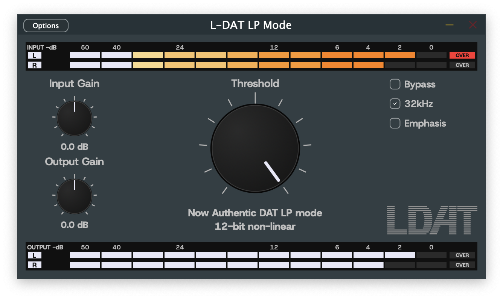

# L-DAT LP Mode



VST3 / AudioUnit effect that emulates the sound of DAT Option 2 (LP mode). It has 12bit nonlinear PCM (RFC3190 / IEC 61119), a 32kHz anti-alias filter and 50/15us emphasis.

ref. [RFC3190](https://datatracker.ietf.org/doc/rfc3190/) RTP Payload Format for 12-bit DAT Audio and 20- and 24-bit Linear Sampled Audio:  K.Kobayashi, A.Ogawa, S.Casner, C.Bormann,


## Requirements

A standalone version is also available.

#### Windows:

- Windows 11 or later, x64
- (Option) VST3 64bit DAW

#### macOS:

- macOS 10.12 or later
- x64 or arm64
- (Option) AU or VST3 DAW

## Install

#### Windows:

Easy on Windows.

1. (option) check SHA256SUM
1. copy the .vst3 file into `C:\Program Files\Common Files\VST3\`

#### macOS:

The pkg you download is not signed, so double-clicking it may not run it.

The au, vst3 and standalone app inside the pkg are self-signed. So Logic or some DAW may show a dialog like "reduced security".

1. (option) check SHA256SUM
1. if double-clicking the pkg does not run it:
   - macOS 14 and older: right-click (or Ctrl-click) the pkg and click "Open", then choose "Open" again in the dialog
   - macOS 15 and later: System Settings -> Privacy & Security -> '"(downloaded pkg)" was blocked to protect your Mac.' -> click "Open Anyway" and enter your password
   - see also: [Safely open apps on your Mac](https://support.apple.com/en-us/102445)

It installs under /Library and /Applications (not under $HOME/).

Why pkg: this binary is not notarized (it costs money), so running it is a bit of a pain. If you unpack .vst3 or .component from a zip or whatever downloaded over the internet and copy it with Finder.app, the files get the quarantine flag, and macOS (Gatekeeper) blocks them when the DAW loads them. Files installed by pkg get no quarantine.

If you don't want to use the pkg installer, you can also unpack and copy by hand, like the example below.

```sh-session
pkgutil --expand-full (downloaded .pkg) ./ldatvst-expand-tmp/
cp -R ldatvst-expand-tmp/au.pkg/Payload/L-DAT_LP_Mode.component ~/Library/Audio/Plug-Ins/Components/  # to install au under $HOME
```


- - - - - - - - -


## Build

JUCE is included as a git submodule. No need to install JUCE or VST3 SDK separately.

### Requirements for build

#### Windows:

- Windows 11 or later
- Visual Studio 2022, "Desktop development with C++" workload (tested with 2022 Community)
- CMake 3.25 or later
- git

#### macOS:

- macOS 10.15 or later
- Xcode, Command line tools for Xcode (tested with Xcode 26, macOS 15)
- CMake 3.25 or later
- git

### How to build

#### Windows:

```sh-session
git clone --recurse-submodules <repo-url>
cd dat-vst-lpmode
cmake --preset vs2022
cmake --build --preset vs2022-release
```

#### macOS:

```sh-session
git clone --recurse-submodules <repo-url>
cd dat-vst-lpmode
cmake --preset mac
cmake --build --preset mac-release
```

The `mac` preset builds a universal 2 binary (arm64 + x86_64) with the Xcode generator. The Xcode generator is a must, not an option. Hardened runtime is set via `XCODE_ATTRIBUTE_*`, and other generators just ignore it.

#### If you cloned without --recurse-submodules

```sh-session
git submodule update --init
```

### Debug build

Use `--preset vs2022-debug` or `--preset mac-debug`.

`cmake --preset ...` generates `build/vs2022/LDatLpMode.sln` or `build/mac/LDatLpMode.xcodeproj`, so you should be able to open them in the IDE too.

### Output

#### Windows

| Format     | Path |
|------------|------|
| VST3       | `build/vs2022/LDatLpMode_artefacts/Release/VST3/L-DAT_LP_Mode.vst3/Contents/x86_64-win/L-DAT_LP_Mode.vst3` |
| Standalone | `build/vs2022/LDatLpMode_artefacts/Release/Standalone/L-DAT_LP_Mode.exe` |

#### macOS

| Format     | Path |
|------------|------|
| VST3       | `build/mac/LDatLpMode_artefacts/Release/VST3/L-DAT_LP_Mode.vst3` |
| AudioUnit  | `build/mac/LDatLpMode_artefacts/Release/AU/L-DAT_LP_Mode.component` |
| Standalone | `build/mac/LDatLpMode_artefacts/Release/Standalone/L-DAT_LP_Mode.app` |

Each macOS bundle has `LICENSE` and `OFL.txt` in `Contents/Resources`. See [License](#license).

To install the VST3 on Windows, copy `L-DAT_LP_Mode.vst3` to:

```
C:\Program Files\Common Files\VST3
```

Then rescan plugins in your DAW.

On macOS, install under `/Library`, same as the release package. Build the package and run it (see [Building the macOS release package](#building-the-macos-release-package)), or copy by hand.

```
sudo ditto build/mac/LDatLpMode_artefacts/Release/AU/L-DAT_LP_Mode.component /Library/Audio/Plug-Ins/Components/L-DAT_LP_Mode.component
sudo ditto build/mac/LDatLpMode_artefacts/Release/VST3/L-DAT_LP_Mode.vst3 /Library/Audio/Plug-Ins/VST3/L-DAT_LP_Mode.vst3
```

`auval` only sees a `.component` that is really installed. Validate the AudioUnit with:

```
auval -v aufx Ldat MIPP
```

If the DAW keeps showing an old build, don't overwrite it. Delete the installed plugin and do a full rescan.

### Installing the macOS release

The macOS release is an installer package, `L-DAT_LP_Mode-<version>-mac.pkg`. It is not signed with an Apple Developer ID, so macOS (Gatekeeper) blocks it the first time you open it. Allow it once.

The installer lets you pick Audio Unit, VST3 and the standalone app. They go to:

| Format     | Path |
|------------|------|
| AudioUnit  | `/Library/Audio/Plug-Ins/Components` |
| VST3       | `/Library/Audio/Plug-Ins/VST3` |
| Standalone | `/Applications` |

If the standalone app runs but the DAW doesn't find the plugin even after restarting the DAW, or `auval` can't see it, rebooting macOS may fix it.

## Building the macOS release package

Release builds are signed with a self-signed certificate, not the default ad-hoc signature. macOS ties the standalone's mic permission to the ad-hoc signature hash, so the TCC permission is lost on every rebuild. Signed with a certificate, even a self-signed one, the permission survives rebuilds and updates, as long as every release is signed with the same certificate.

Create the certificate once in Keychain Access.

1. Keychain Access > Certificate Assistant > Create a Certificate.
2. Pick a name, set Identity Type to "Self Signed Root" and Certificate Type to "Code Signing".
3. Check "Let me override defaults" and set a long validity period (e.g. 7300 days). Default is 1 year.
4. Export the certificate with its private key as `.p12` and keep a backup. If the certificate changes, every user has to allow mic access again.

The first build asks for access to the key. Choose "Always Allow".

Add `CMakeUserPresets.json` next to `CMakePresets.json`. The certificate name is your own, so this file is in .gitignore.

```json
{
  "version": 6,
  "configurePresets": [
    {
      "name": "mac-selfsigned",
      "inherits": "mac",
      "cacheVariables": {
        "CMAKE_XCODE_ATTRIBUTE_CODE_SIGN_IDENTITY": "<your certificate name>",
        "CMAKE_XCODE_ATTRIBUTE_CODE_SIGN_STYLE": "Manual"
      }
    }
  ],
  "buildPresets": [
    { "name": "mac-selfsigned-release", "configurePreset": "mac-selfsigned", "configuration": "Release" }
  ]
}
```

Build and package:

```sh-session
cmake --preset mac-selfsigned
cmake --build --preset mac-selfsigned-release
bash packaging/mac/build_pkg.sh build/mac-selfsigned
```

The script writes `build/mac-selfsigned/L-DAT_LP_Mode-<version>-mac.pkg`. It warns if a bundle is ad-hoc signed. The pkg itself stays unsigned.

## Tests

#### Windows

`ctest --preset vs2022-release`

#### macOS

`ctest --preset mac-release`

## License

L-DAT LP Mode is under the [GNU Affero General Public License v3](LICENSE). JUCE is used under the same license too.

The plugin embeds the Host Grotesk font (Copyright 2023 The Host Grotesk Project Authors) under the [SIL Open Font License 1.1](resources/fonts/Host_Grotesk/OFL.txt). The font is not covered by the AGPL. See the additional permission at the top of `LICENSE` for details.

By OFL section 2, the font's copyright notice and full license text must go with every copy. Release packages must ship `LICENSE` and `fonts/Host_Grotesk/OFL.txt`. This applies to the macOS package too, for every format in it. On macOS the build puts both files into `Contents/Resources` of every bundle, and the installer shows them on its license page too.
