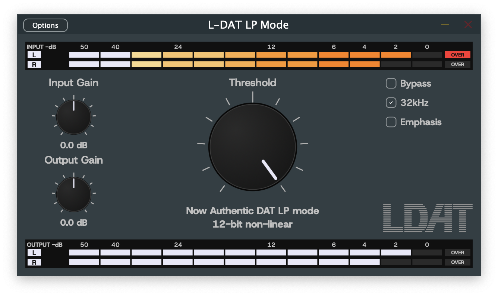

# L-DAT LP Mode



DAT Option 2 (LP mode) のサウンドをエミュレーションする VST3 / AudioUnit エフェクトです。12bit 非直線 PCM (RFC3190 / IEC 61119)、32kHz のアンチエイリアスフィルタ、50/15us エンファシスを備えます。

ref. [RFC3190](https://datatracker.ietf.org/doc/rfc3190/) RTP Payload Format for 12-bit DAT Audio and 20- and 24-bit Linear Sampled Audio:  K.Kobayashi, A.Ogawa, S.Casner, C.Bormann,


## Requirements

スタンドアロン版も入っています。

#### Windows:

- Windows 11以降 x64
- (Option) VST3 64bit DAW

#### macOS:

- macOS 10.12 以降
- x64 または arm64
- (Option) AU または VST3 DAW

## Install

#### Windows:

Windows の場合は簡単です

1. (option) SHA256SUMをチェックする
1. .vst3 ファイルを `C:\Program Files\Common Files\VST3\` にコピーする

#### macOS:

ダウンロードした pkg は未署名のためダブルクリックしても実行できないことがあります。

pkg の中身の au, vst3, standalone app は自己署名です。そのため Logic とかが「セキュリティの低下」みたいなダイアログを出すことがあります。

1. (option) SHA256SUMをチェックする
1. pkg をダブルクリックして実行できなかった場合、
   - macOS14以前: pkg を右クリックで"開く"をクリック(またはCtrl-クリック)、ダイアログでもう一度「開く」を選ぶ
   - macOS15以降: システム設定 -> プライバシーとセキュリティ -> お使いのMacを保護するために"(ダウンロードしたpkg)"がブロックされました・「このまま開く」をクリックしてパスワードを入力する
   - 参考: [Macでアプリを安全に開く](https://support.apple.com/ja-jp/102445)

インストール先は /Library, /Applications 以下です ($HOME/ 以下ではありません)。

pkg形式にしてある理由は、このバイナリは費用をかけてノータリゼーションされておらず実行がやや面倒だからです。もしインターネット経由でダウンロードした zip などから .vst3 や .component を展開して Finder.app でコピーするとそのファイルは quarantine つきになり、DAW で読み込む際に macOS(Gatekeeper) にブロックされます。pkg でインストールされたファイルは quarantine がつきません。

もしpkgインストーラを利用したくない場合、下記の例のように手動で展開してコピーする方法もあります。

```sh-session
pkgutil --expand-full (ダウンロードした.pkg) ./ldatvst-expand-tmp/
cp -R ldatvst-expand-tmp/au.pkg/Payload/L-DAT_LP_Mode.component ~/Library/Audio/Plug-Ins/Components/  # au を $HOME以下にインストールする場合
```


- - - - - - - - -


## Build

JUCE は git submodule として同梱しています。JUCE や VST3 SDK を別途インストールする必要はありません。

### Requirements for build

#### Windows:

- Windows 11 以降
- Visual Studio 2022, C++ によるデスクトップ開発ワークロード (2022 Communityで確認)
- CMake 3.25 以降
- git

#### macOS:

- macOS 10.15 以降
- Xcode, Command line tools for Xcode (Xcode 26, macOS 15 で確認)
- CMake 3.25 以降
- git

### How to build

#### Windows:

```sh-session
git clone --recurse-submodules <repo-url>
cd dat-vst-lpmode
cmake --preset vs2022
cmake --build --preset vs2022-release
```

#### macOS:

```sh-session
git clone --recurse-submodules <repo-url>
cd dat-vst-lpmode
cmake --preset mac
cmake --build --preset mac-release
```

`mac` プリセットは Xcode ジェネレータで universal 2 バイナリ (arm64 + x86_64) をビルドします。Xcode ジェネレータは選択肢ではなく必須です。hardened runtime は `XCODE_ATTRIBUTE_*` 経由で設定されるため、他のジェネレータでは無視されます。

#### もし --recurse-submodules なしで clone してしまった場合

```sh-session
git submodule update --init
```

### Debug build

`--preset vs2022-debug` または `--preset mac-debug` を指定します。

cmake --preset ... では, `build/vs2022/LDatLpMode.sln` や `build/mac/LDatLpMode.xcodeproj` が生成され、IDE でも開けるはずです。

### 出力

#### Windows

| Format     | Path |
|------------|------|
| VST3       | `build/vs2022/LDatLpMode_artefacts/Release/VST3/L-DAT_LP_Mode.vst3/Contents/x86_64-win/L-DAT_LP_Mode.vst3` |
| Standalone | `build/vs2022/LDatLpMode_artefacts/Release/Standalone/L-DAT_LP_Mode.exe` |

#### macOS

| Format     | Path |
|------------|------|
| VST3       | `build/mac/LDatLpMode_artefacts/Release/VST3/L-DAT_LP_Mode.vst3` |
| AudioUnit  | `build/mac/LDatLpMode_artefacts/Release/AU/L-DAT_LP_Mode.component` |
| Standalone | `build/mac/LDatLpMode_artefacts/Release/Standalone/L-DAT_LP_Mode.app` |

macOS の各バンドルには `Contents/Resources` に `LICENSE` と `OFL.txt` が含まれます。[ライセンス](#ライセンス) を参照してください。

Windows で VST3 をインストールするには `L-DAT_LP_Mode.vst3` を次の場所へコピーします。

```
C:\Program Files\Common Files\VST3
```

その後 DAW でプラグインを再スキャンしてください。

macOS では、リリースパッケージと同じ `/Library` 以下へインストールします。パッケージをビルドして実行する ([macOS リリースパッケージのビルド](#macos-リリースパッケージのビルド) を参照) か、手動でコピーします。

```
sudo ditto build/mac/LDatLpMode_artefacts/Release/AU/L-DAT_LP_Mode.component /Library/Audio/Plug-Ins/Components/L-DAT_LP_Mode.component
sudo ditto build/mac/LDatLpMode_artefacts/Release/VST3/L-DAT_LP_Mode.vst3 /Library/Audio/Plug-Ins/VST3/L-DAT_LP_Mode.vst3
```

`auval` は実際にインストールされた `.component` しか見ません。AudioUnit の検証は次のコマンドで行います。

```
auval -v aufx Ldat MIPP
```

DAW が古いビルドを表示し続ける場合は、上書きではなくインストール済みのプラグインを削除してフルリスキャンしてください。

### macOS リリース版のインストール

macOS リリース版はインストーラパッケージ `L-DAT_LP_Mode-<version>-mac.pkg` です。Apple Developer ID で署名されていないため、初回に開くと macOS(Gatekeeper) がブロックします。一度だけ許可してください。

インストーラでは Audio Unit、VST3、スタンドアロンアプリを選択できます。インストール先は次のとおりです。

| Format     | Path |
|------------|------|
| AudioUnit  | `/Library/Audio/Plug-Ins/Components` |
| VST3       | `/Library/Audio/Plug-Ins/VST3` |
| Standalone | `/Applications` |

Standalone app は起動できるのに DAW を再起動してもプラグインが検出されない、`auval` で確認できない、などの場合はmacOS再起動で解決することがあります。

## macOS リリースパッケージのビルド

リリースビルドは、デフォルトの ad-hoc 署名ではなく自己署名証明書で署名します。macOS は standalone 版の microphone 許可を ad-hoc 署名のハッシュに紐付けるため、リビルドのたびに TCC 許可が失われます。自己署名でも証明してあればリビルドやアップデートをまたいで許可が維持されます。

証明書は キーチェーンアクセス で一度だけ作成します。

1. キーチェーンアクセス > 証明書アシスタント > 証明書を作成。
2. 名前を決め、固有名の種類を「自己署名ルート」、証明書のタイプを「コード署名」にします。
3. 「デフォルトを無効化」にチェックを入れ、有効期間を長く (例: 7300 日) 設定します。デフォルトは 1 年です。
4. 証明書を秘密鍵ごと `.p12` として書き出し、バックアップを保管します。証明書が変わると、すべてのユーザーがマイクアクセスを再度許可する必要があります。

`CMakePresets.json` と同じ場所に `CMakeUserPresets.json` を追加します。証明書名は各自のものなので、このファイルは .gitignore されています。

```json
{
  "version": 6,
  "configurePresets": [
    {
      "name": "mac-selfsigned",
      "inherits": "mac",
      "cacheVariables": {
        "CMAKE_XCODE_ATTRIBUTE_CODE_SIGN_IDENTITY": "<your certificate name>",
        "CMAKE_XCODE_ATTRIBUTE_CODE_SIGN_STYLE": "Manual"
      }
    }
  ],
  "buildPresets": [
    { "name": "mac-selfsigned-release", "configurePreset": "mac-selfsigned", "configuration": "Release" }
  ]
}
```

ビルドとパッケージ作成:

```sh-session
cmake --preset mac-selfsigned
cmake --build --preset mac-selfsigned-release
bash packaging/mac/build_pkg.sh build/mac-selfsigned
```

スクリプトは `build/mac-selfsigned/L-DAT_LP_Mode-<version>-mac.pkg` を出力します。ad-hoc 署名のバンドルがあると警告を出します。pkg 自体は未署名のままです。

## テスト

#### Windows

`ctest --preset vs2022-release`

#### macOS

`ctest --preset mac-release`

## ライセンス

L-DAT LP Mode は [GNU Affero General Public License v3](LICENSE) です。
JUCE も同じライセンスで使用しています。

プラグインには Host Grotesk フォント (Copyright 2023 The Host Grotesk Project Authors) が [SIL Open Font License 1.1](resources/fonts/Host_Grotesk/OFL.txt) のもとで埋め込まれています。フォントは AGPL の対象外です。詳細は `LICENSE` 冒頭の追加許可を参照してください。

OFL 第 2 項により、フォントの著作権表示とライセンス全文はすべてのコピーに付随する必要があります。配布パッケージには `LICENSE` と `fonts/Host_Grotesk/OFL.txt` を必ず同梱してください。これは macOS のパッケージにも、その中のすべての形式について適用されます。macOS ではビルドが両ファイルをすべてのバンドルの `Contents/Resources` に配置し、インストーラのライセンス画面にも表示されます。
